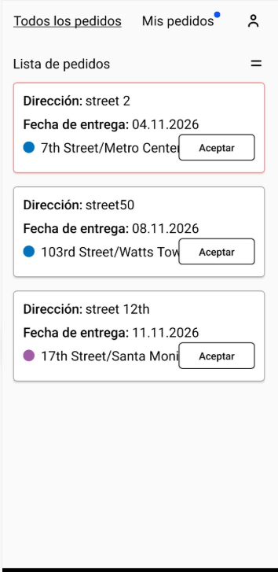

# KAN-18 — Accept Button Overlaps Metro Station Name | Superposición del botón Aceptar

**Project:** Urban Scooter  
**Bug ID:** KAN-18  
**Severity:** Minor (Menor)  
**Testing Type:** Mobile UI Testing, Functional Testing  
**Platform:** Android  
**Status:** Documented during TripleTen QA training

---

# English

## Bug Description

In the "All Orders" tab of the Urban Scooter mobile application, collapsed order cards containing long metro station names have a layout issue.

The "Accept" button overlaps the metro station name, preventing the complete text from being displayed and causing a difference from the Figma design.

## Test Environment

- Application: Urban Scooter (mobile version)
- Device: Samsung Galaxy S20 Ultra
- Operating system: Android 13
- Test server: Configured and available
- Screen: All Orders
- Card state: Collapsed
- Metro station: 7th Street/Metro Center
- Design reference: Figma

## Steps to Reproduce

1. Log in to the Urban Scooter mobile application with a registered courier.
2. Navigate to "All Orders".
3. Find an available order with a long metro station name, such as "7th Street/Metro Center".
4. Keep the order card collapsed.
5. Observe the metro station name and the position of the "Accept" button.

## Expected Result

The collapsed order card should display the address, delivery date, and metro station name according to the Figma design.

The metro station name and the "Accept" button should be visible without overlapping or hiding information.

## Actual Result

The "Accept" button overlaps the metro station name "7th Street/Metro Center", hiding part of the text and preventing it from being displayed completely.

## Impact

- Reduced readability of order information.
- Incomplete visibility of long metro station names.
- Visual inconsistency with the Figma design.

---

# Español

## Descripción del defecto

En la pestaña «Todos los pedidos» de la aplicación móvil Urban Scooter, las tarjetas contraídas que contienen nombres largos de estaciones de metro presentan un problema de distribución.

El botón «Aceptar» se superpone al nombre de la estación, impidiendo visualizarlo completamente y provocando una diferencia respecto al diseño de Figma.

## Configuración del sistema

- Aplicación: Urban Scooter (versión móvil)
- Dispositivo: Samsung Galaxy S20 Ultra
- Sistema operativo: Android 13
- Servidor de pruebas: configurado y disponible
- Pantalla: «Todos los pedidos»
- Presentación de tarjetas: contraídas
- Estación de metro: «7th Street/Metro Center»
- Diseño de referencia: Figma

## Pasos para reproducir

1. Iniciar sesión en la aplicación móvil Urban Scooter con un repartidor registrado.
2. Acceder a «Todos los pedidos».
3. Localizar un pedido disponible cuya estación de metro tenga un nombre largo, como «7th Street/Metro Center».
4. Mantener la tarjeta del pedido contraída.
5. Observar la distribución del nombre de la estación y la posición del botón «Aceptar».

## Resultado esperado

La tarjeta contraída debe mostrar la dirección, la fecha de entrega y el nombre de la estación de metro conforme al diseño de Figma.

El nombre de la estación y el botón «Aceptar» deben visualizarse sin superponerse ni ocultar información.

## Resultado actual

El botón «Aceptar» se superpone al nombre de la estación de metro «7th Street/Metro Center» y oculta parte del texto, impidiendo visualizarlo completamente.

## Impacto

- Dificultad para leer la información del pedido.
- Visualización incompleta de nombres largos de estaciones.
- Diferencia visual respecto al diseño de Figma.

---

# Evidence | Evidencia

## Mobile UI Screenshot | Captura de interfaz móvil

Screenshot showing the "Accept" button overlapping the metro station name in a collapsed order card.

Captura que muestra cómo el botón «Aceptar» se superpone al nombre de la estación de metro en una tarjeta contraída.

---

## QA Skills Demonstrated | Competencias demostradas

- Mobile application testing on Android.
- User interface validation.
- Functional testing.
- Layout and text visibility verification.
- Comparison against Figma designs.
- Defect reporting with visual evidence.

**Project:** Urban Scooter  
**Training:** TripleTen QA Engineering Bootcamp  
**Bug reference:** KAN-18
