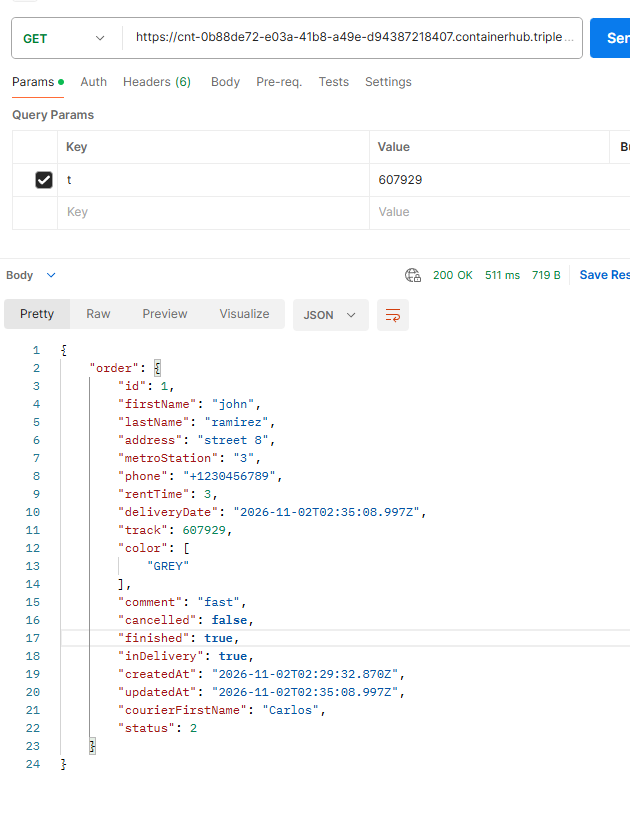
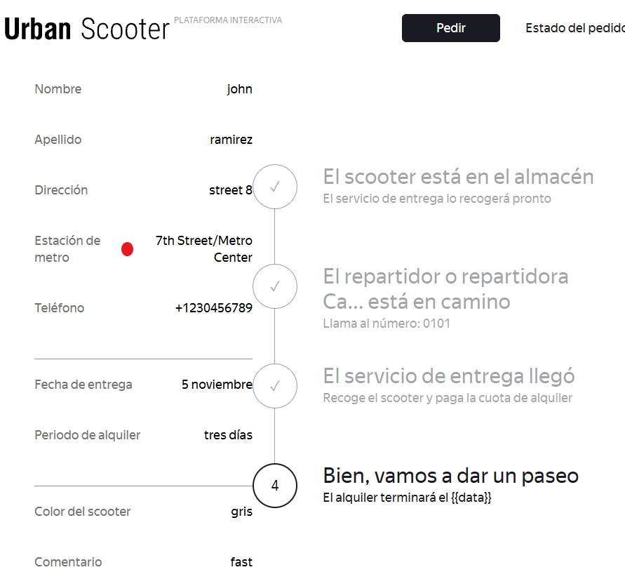

# KAN-2 — Incorrect Order Status Transition | Transición incorrecta del estado del pedido

## English

### Bug ID
KAN-2

### Title
Order skips from "Courier is on the way" to "Let's go for a ride" after completing the order.

### Description
When an order is completed through the API, the Urban Scooter web application does not correctly display the intermediate status "Delivery service has arrived" as active.

Instead, this status is shown as already completed, and the interface directly activates "Let's go for a ride".

### Severity
Grave

### Test Environment
- Operating system: Windows 11
- Browsers: Google Chrome and Opera
- Application: Urban Scooter (web version)
- Test order: 607929

### Backend State
After completing the order through the API:

- `finished: true`
- `inDelivery: true`
- `status: 2`

### Steps to Reproduce
1. Create a valid order in Urban Scooter.
2. Assign the order to a courier.
3. Verify that the order is in the "Courier is on the way" status.
4. Execute the "Complete order" action through the API.
5. Check the order status again in the web application.
6. Observe the sequence of statuses displayed in the interface.

### Expected Result
After completing the order through the API, the application should display "Delivery service has arrived" as the active status, according to the requirement stating that this status becomes active when the courier clicks "Complete".

### Actual Result
After completing the order through the API, the application displays "Delivery service has arrived" as an already completed status and directly activates "Let's go for a ride".

### Testing Techniques
- Manual functional testing
- API testing
- Web interface validation
- Order state transition verification

---

## Español

### ID del defecto
KAN-2

### Título
El pedido salta del estado "El repartidor está en camino" al estado "Bien, vamos a dar un paseo" después de completar el pedido.

### Descripción
Al completar un pedido desde la API, la aplicación web no muestra correctamente el estado intermedio "El servicio de entrega llegó" como estado activo.

En su lugar, ese estado aparece directamente como superado y la interfaz activa "Bien, vamos a dar un paseo".

### Severidad
Grave

### Configuración del sistema
- Sistema operativo: Windows 11
- Navegadores: Google Chrome y Opera
- Aplicación: Urban Scooter (versión web)
- Pedido utilizado: 607929

### Estado del backend
Después de completar el pedido mediante la API:

- `finished: true`
- `inDelivery: true`
- `status: 2`

### Pasos a seguir
1. Crear un pedido válido en Urban Scooter.
2. Asignar el pedido a un repartidor.
3. Verificar que el pedido se encuentre en el estado "El repartidor o repartidora está en camino".
4. Ejecutar la acción "Completar el pedido" mediante la API.
5. Consultar nuevamente el estado del pedido en la aplicación web.
6. Observar la secuencia de estados mostrada en la interfaz.

### Resultado esperado
Después de completar el pedido mediante la API, la aplicación debe mostrar "El servicio de entrega llegó" como estado activo, de acuerdo con el requisito que establece que este estado se activa cuando el repartidor pulsa "Completar".

### Resultado actual
Después de completar el pedido mediante la API, la aplicación muestra "El servicio de entrega llegó" como un estado ya superado y activa directamente "Bien, vamos a dar un paseo".

### Técnicas de prueba
- Pruebas funcionales manuales
- Pruebas de API
- Validación de interfaz web
- Verificación de transiciones de estado del pedido

---

## Evidence | Evidencia

### Screenshot 1 | Captura 1

### Screenshot 2 | Captura 2

