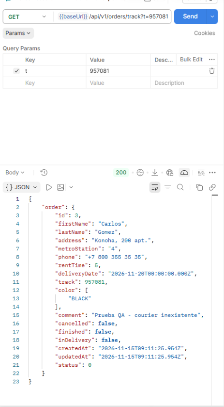
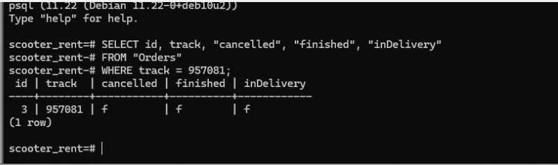
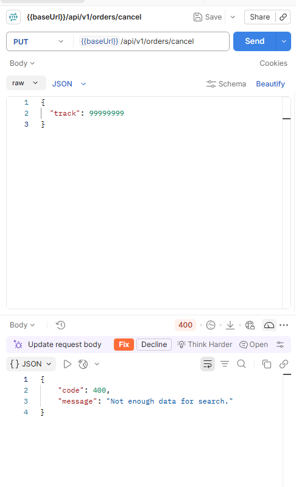
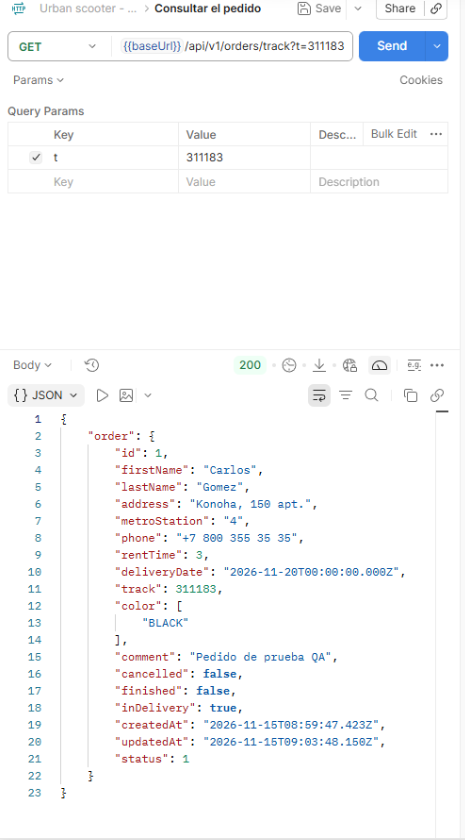

# KAN-34 — Order Cancellation API Returns HTTP 400 | La API de cancelación devuelve HTTP 400

**Project:** Urban Scooter  
**Bug ID:** KAN-34  
**Severity:** Major (Grave)  
**Testing Type:** API Testing, Functional Testing, Database Validation  
**Tools:** Postman, PostgreSQL, SQL  
**Status:** Documented during TripleTen QA training

---

# English

## Bug Description

The Urban Scooter API returns HTTP 400 Bad Request when attempting to cancel an order through `PUT /api/v1/orders/cancel`, even when a valid tracking number is provided.

The same response occurs when using a nonexistent tracking number or attempting to cancel an order that is already being processed.

Instead of returning the HTTP status codes specified in the API documentation, all three scenarios return the same error:

```json
{
  "code": 400,
  "message": "Not enough data for search."
}
```

Additionally, cancellation was observed to fail through the Urban Scooter web interface.

## Test Environment

- Operating system: Windows 11
- Application: Urban Scooter REST API
- API testing tool: Postman
- Database: PostgreSQL
- Database table: `Orders`
- HTTP method: `PUT`
- Endpoint: `{{baseUrl}}/api/v1/orders/cancel`
- Request body format: JSON
- Verification endpoint: `GET /api/v1/orders/track?t={track}`
- Test server: Running and available

## Steps to Reproduce

### Scenario 1 — Cancel an Existing Order

1. Open Postman.
2. Select the PUT method.
3. Enter `{{baseUrl}}/api/v1/orders/cancel`.
4. Select Body → raw → JSON.
5. Send the following request:

```json
{
  "track": 957081
}
```

6. Check the HTTP status code and response body.
7. Retrieve the order using `GET /api/v1/orders/track?t=957081`.
8. Verify `cancelled`, `finished`, `inDelivery`, and `status`.
9. Query the `Orders` table in PostgreSQL to verify the `cancelled` value.

**Expected Result**

The API should return HTTP 200 OK:

```json
{
  "ok": true
}
```

The order should be updated to:

- `cancelled = true`
- `status = -1`

This applies when `finished` is not `true`.

**Actual Result**

The API returns HTTP 400 Bad Request:

```json
{
  "code": 400,
  "message": "Not enough data for search."
}
```

The order remains unchanged:

- `cancelled = false`
- `finished = false`
- `inDelivery = false`
- `status = 0`

A PostgreSQL query also confirmed that `cancelled` remained `false`.

### Scenario 2 — Cancel a Nonexistent Order

1. Open Postman.
2. Select PUT and enter `/api/v1/orders/cancel`.
3. Send:

```json
{
  "track": 99999999
}
```

4. Check the response.

**Expected Result**

HTTP 404 Not Found, indicating that the order does not exist.

**Actual Result**

HTTP 400 Bad Request with the message:

`Not enough data for search.`

### Scenario 3 — Cancel an Order in Processing

1. Retrieve the order using `GET /api/v1/orders/track?t=311183`.
2. Confirm:
   - `inDelivery = true`
   - `status = 1`
3. Send a PUT request to `/api/v1/orders/cancel` with:

```json
{
  "track": 311183
}
```

4. Check the response.

**Expected Result**

HTTP 409 Conflict, indicating that the order is already being processed.

**Actual Result**

HTTP 400 Bad Request with the message:

`Not enough data for search.`

## Test Results Summary

| Scenario | Expected HTTP | Actual HTTP | Result |
|---|---|---|---|
| Existing order | 200 OK | 400 Bad Request | FAILED |
| Nonexistent order | 404 Not Found | 400 Bad Request | FAILED |
| Order in processing | 409 Conflict | 400 Bad Request | FAILED |

## Database Verification

The existing order was verified using PostgreSQL.

```sql
SELECT id, track, "cancelled", "finished", "inDelivery"
FROM "Orders"
WHERE track = 957081;
```

The query returned:

| id | track | cancelled | finished | inDelivery |
|---|---|---|---|---|
| 3 | 957081 | false | false | false |

This confirms that the cancellation did not update the order's cancellation status.

---

# Español

## Descripción del defecto

La API de Urban Scooter devuelve HTTP 400 Bad Request al intentar cancelar un pedido mediante `PUT /api/v1/orders/cancel`, incluso cuando se proporciona un número de seguimiento válido.

El mismo comportamiento se presenta con un número de seguimiento inexistente y con un pedido que ya se encuentra en procesamiento.

En lugar de devolver los códigos HTTP documentados, los tres escenarios presentan:

```json
{
  "code": 400,
  "message": "Not enough data for search."
}
```

Adicionalmente, se observó que la cancelación tampoco se completa desde la interfaz web.

## Configuración del sistema

- Sistema operativo: Windows 11
- Aplicación: API REST de Urban Scooter
- Herramienta: Postman
- Base de datos: PostgreSQL
- Tabla: `Orders`
- Método: `PUT`
- Endpoint: `{{baseUrl}}/api/v1/orders/cancel`
- Formato del cuerpo: JSON
- Consulta: `GET /api/v1/orders/track?t={track}`
- Servidor de pruebas: iniciado y disponible

## Pasos para reproducir

### Escenario 1 — Cancelar un pedido existente

1. Abrir Postman.
2. Seleccionar el método PUT.
3. Introducir `{{baseUrl}}/api/v1/orders/cancel`.
4. Seleccionar Body → raw → JSON.
5. Enviar:

```json
{
  "track": 957081
}
```

6. Observar el código HTTP y la respuesta.
7. Consultar `GET /api/v1/orders/track?t=957081`.
8. Verificar los campos `cancelled`, `finished`, `inDelivery` y `status`.
9. Consultar la tabla `Orders` en PostgreSQL.

**Resultado esperado**

HTTP 200 OK:

```json
{
  "ok": true
}
```

El pedido debe actualizarse con:

- `cancelled = true`
- `status = -1`

Siempre que `finished` no sea `true`.

**Resultado actual**

HTTP 400 Bad Request:

```json
{
  "code": 400,
  "message": "Not enough data for search."
}
```

El pedido conserva:

- `cancelled = false`
- `finished = false`
- `inDelivery = false`
- `status = 0`

La consulta a PostgreSQL confirmó que `cancelled` permaneció en `false`.

### Escenario 2 — Número de seguimiento inexistente

1. Seleccionar PUT en Postman.
2. Introducir `/api/v1/orders/cancel`.
3. Enviar:

```json
{
  "track": 99999999
}
```

4. Observar la respuesta.

**Resultado esperado**

HTTP 404 Not Found, indicando que el pedido no existe.

**Resultado actual**

HTTP 400 Bad Request con el mensaje:

`Not enough data for search.`

### Escenario 3 — Pedido en procesamiento

1. Consultar `GET /api/v1/orders/track?t=311183`.
2. Verificar:
   - `inDelivery = true`
   - `status = 1`
3. Enviar PUT a `/api/v1/orders/cancel` con:

```json
{
  "track": 311183
}
```

4. Observar la respuesta.

**Resultado esperado**

HTTP 409 Conflict, indicando que el pedido está en procesamiento.

**Resultado actual**

HTTP 400 Bad Request con el mensaje:

`Not enough data for search.`

## Resumen de resultados

| Escenario | HTTP esperado | HTTP actual | Estado |
|---|---|---|---|
| Pedido existente | 200 OK | 400 Bad Request | NO APROBADO |
| Pedido inexistente | 404 Not Found | 400 Bad Request | NO APROBADO |
| Pedido en procesamiento | 409 Conflict | 400 Bad Request | NO APROBADO |

## Verificación en PostgreSQL

```sql
SELECT id, track, "cancelled", "finished", "inDelivery"
FROM "Orders"
WHERE track = 957081;
```

Resultado obtenido:

| id | track | cancelled | finished | inDelivery |
|---|---|---|---|---|
| 3 | 957081 | false | false | false |

La consulta confirma que el estado de cancelación no se actualizó.

---

# Evidence | Evidencia

## Evidence 1 — Existing Order | Pedido existente

GET request confirming that order `957081` exists and remains uncancelled.

Consulta GET que confirma que el pedido `957081` existe y permanece sin cancelar.



## Evidence 2 — Database Verification | Verificación en PostgreSQL

SQL query confirming `cancelled = false`.

Consulta SQL que confirma `cancelled = false`.



## Evidence 3 — Nonexistent Order | Pedido inexistente

PUT request showing HTTP 400 instead of the documented HTTP 404.

Solicitud PUT que devuelve HTTP 400 en lugar del HTTP 404 documentado.



## Evidence 4 — Order in Processing | Pedido en procesamiento

GET request confirming `inDelivery = true` and `status = 1`.

Consulta GET que confirma `inDelivery = true` y `status = 1`.



---

## QA Skills Demonstrated | Competencias demostradas

- REST API testing with Postman.
- HTTP status code validation.
- Positive and negative test scenarios.
- SQL database verification using PostgreSQL.
- Backend data consistency checks.
- Functional defect documentation.
- Test evidence collection and traceability.

**Project:** Urban Scooter  
**Training program:** TripleTen QA Engineering Bootcamp  
**Bug reference:** KAN-34
